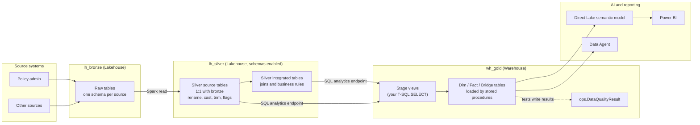
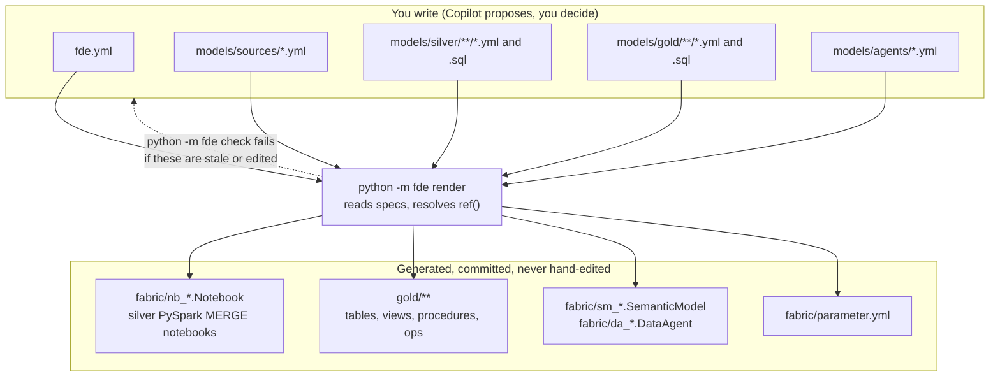
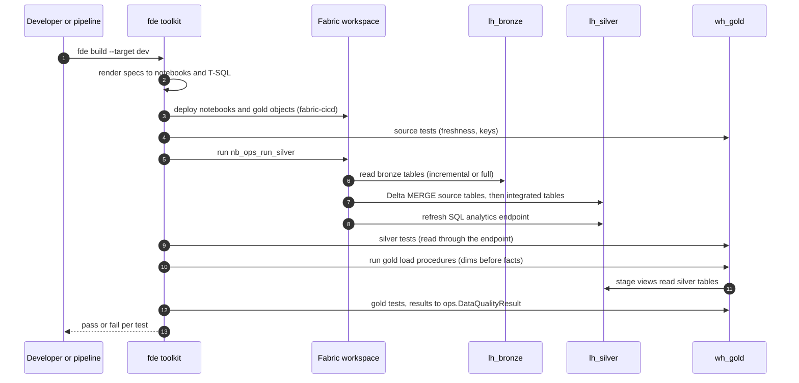

# How the kit works: `fde.yml`, dbt parallels, architecture and data flow

A high-level explanation for people who know dbt. The kit does for Microsoft
Fabric what dbt does for a warehouse: you write table **specs** and
**SELECTs**, and the `fde` toolkit generates the code, deploys it, runs it and
tests it. Unlike dbt, it targets two Fabric engines: PySpark notebooks on a
Lakehouse (silver) and T-SQL stored procedures on a Warehouse (gold).

## 1. What `fde.yml` is

`fde.yml` is the project settings file. It plays the role of dbt's
`dbt_project.yml` and `profiles.yml` together, and it holds no secrets.

| Section | What it does | dbt equivalent |
| --- | --- | --- |
| `project` | Project name (snake_case); used to name the semantic model | `name:` in `dbt_project.yml` |
| `items` | Names of the three Fabric items: bronze Lakehouse, silver Lakehouse, gold Warehouse. The same in every workspace | `database` / `schema` targets in `profiles.yml` |
| `silver` | Silver run settings: notebook concurrency, optional `install_wheel` | `threads:` plus run settings |
| `ai` | Semantic model name and the PII rule for AI items | no equivalent (dbt metrics/semantic layer) |
| `defaults.freshness` | Default freshness rule written into new source specs | `freshness:` on sources |
| `targets` | `dev`, `test`, `prod`. Each one names the **environment variables** that hold the SQL endpoint and workspace id. `test` and `prod` are `protected`: only the release pipeline writes to them | `outputs:` in `profiles.yml` |

Hosts, workspace ids and tokens live in environment variables
(`FABRIC_DEV_SQL_ENDPOINT`, `FABRIC_DEV_WORKSPACE_ID`, ...), never in a file.
Item names stay the same in every workspace. `fabric/parameter.yml` (rendered)
swaps the ids per environment when `fabric-cicd` deploys.

## 2. The dbt parallels at a glance

| Idea | dbt | This kit |
| --- | --- | --- |
| Table definition | `models/**/*.sql` + `schema.yml` | `models/**/<Table>.yml` spec (+ `.sql` for joins and rules) |
| Raw inputs | `sources:` + `{{ source() }}` | `models/sources/<source>.yml` + `{{ source() }}` (bronze) |
| Dependencies | `{{ ref('model') }}` | `{{ ref('schema.Table') }}`: item and schema names are never hard-coded |
| Layers | staging, intermediate, marts | silver source tables, silver integrated tables, gold `Dim` / `Fact` / `Bridge` |
| Compile | `dbt compile` | `python -m fde render` writes Fabric notebooks and T-SQL |
| Parse / lineage | `dbt parse`, `manifest.json` | `python -m fde parse`, `target/manifest.json` |
| Lint | sqlfluff, project evaluator | `python -m fde check`: all rules plus "rendered files are up to date" |
| Build | `dbt build` | `python -m fde build --target dev`: deploy, run silver, load gold, test |
| Tests | generic and singular tests | kit adds key, uniqueness, SCD2 and relationship tests; you add `accepted_values`, `accepted_range`, `expression`, `reconciles_to`, `recency` |
| Ad hoc query | `dbt show` | `python -m fde show "select ..."` |
| Connection check | `dbt debug` | `python -m fde debug --target dev` |
| Docs | `dbt docs` | descriptions on every table and column feed the Information Matrix |

Where it differs from dbt: the output is not a SELECT run by a warehouse.
`render` produces **Delta MERGE notebooks** for silver and **one stored
procedure per table** for gold. The rendered files are committed so reviewers
see what runs, but nobody edits them (rule R1; `fde check` fails on hand edits
and stale files).

## 3. Data architecture

Four layers, each in its own Fabric item. Bronze is loaded by pipelines, not by
this repo. Silver and gold are built from specs.

Layer rules (never broken):

- A silver source table reads exactly one bronze table. It never joins or
  applies business rules.
- Joins and rules go in silver integrated tables or in the gold SELECT.
- Silver never reads gold.
- Gold reads silver (through the Lakehouse SQL analytics endpoint) and other
  gold tables, always through `{{ ref() }}`.

## 4. What you write and what is generated

## 5. Data flow of a build and of the daily load

`python -m fde build --target dev` runs these steps. The daily pipeline
(`pl_daily_load`) runs the same load and test steps on a schedule.

Data flow of one table, end to end:

```mermaid
flowchart LR
    R["Bronze row<br/>(raw, as landed)"]
    C["Silver source row<br/>conformed columns<br/>_BK key + 4 audit columns"]
    I["Silver integrated row<br/>joined, business rules"]
    V["Gold stage view<br/>point-in-time dim key lookup,<br/>coalesce to -1"]
    T["Gold Dim / Fact row<br/>_SK key, StartDate, EndDate, IsCurrent"]
    M["Semantic model measure<br/>sum / avg / count over a column"]

    R -->|"expression per column"| C
    C -->|"SELECT with ref()"| I
    I -->|"T-SQL SELECT with ref()"| V
    V -->|"MERGE in a stored procedure"| T
    T -->|"Direct Lake"| M
```

## 6. Where tests and environments fit

- **Tests** run after each layer. The kit adds key, uniqueness, SCD2 and
  relationship tests to every table. The spec adds business tests.
  A failing test is a data-quality finding: it is reported, never deleted or
  weakened.
- **Environments:** `--target dev` is the only target a laptop can write to.
  `test` and `prod` are `protected: true` in `fde.yml`. Only the release
  pipeline (with `FDE_ALLOW_PROTECTED=1`) writes to them.

## 7. Known Fabric behaviours the kit handles

- **Name case:** Spark stores Lakehouse tables in lower case, and the Warehouse
  resolves names case-sensitively. For silver tables read from the Warehouse,
  the kit lower-cases the schema and table name in T-SQL
  (`Project.relation()`), so specs can keep PascalCase names.
- **Shared library:** silver notebooks import `fabric_de_common`. It comes from
  a Fabric Environment by default, or from a wheel installed in each notebook
  when `silver.install_wheel` is set (see `START_HERE.md`, step 5).
