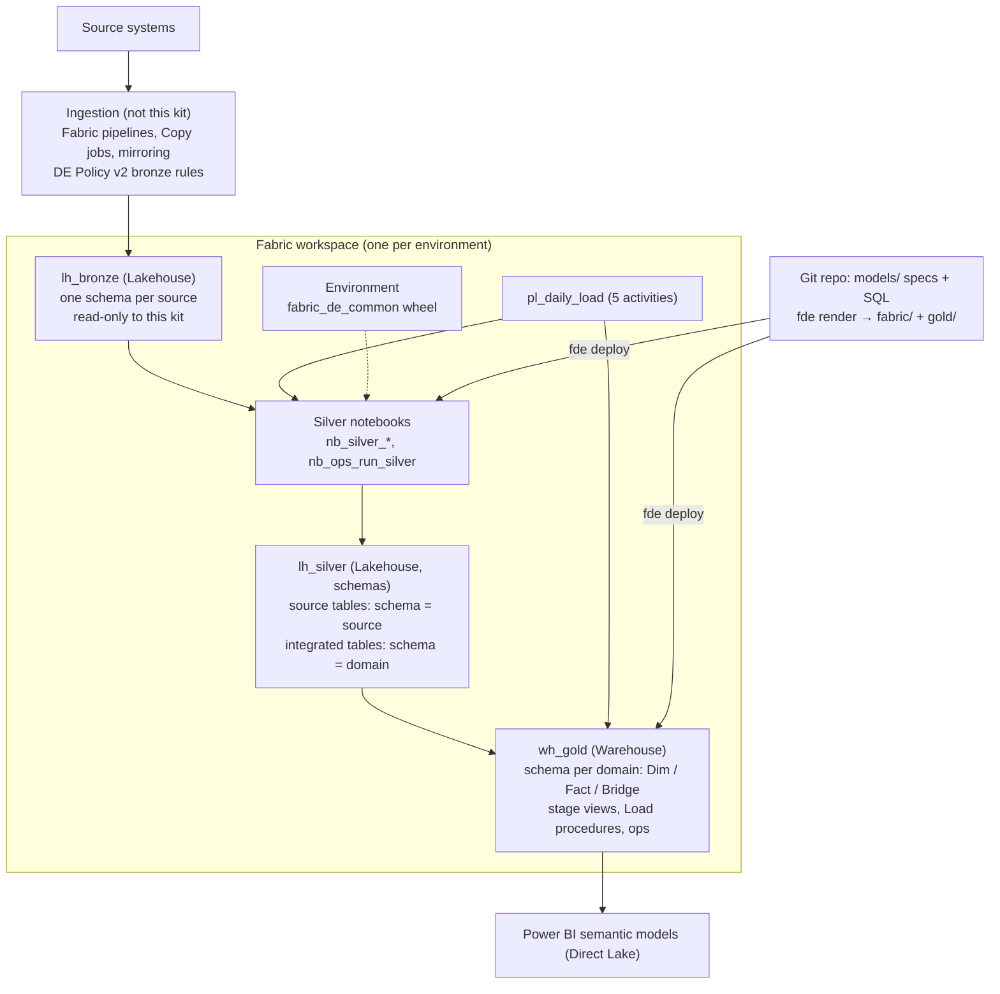

# Microsoft Fabric Data Engineering Standards (no dbt)

Nov 4, 2026 · Sanmari Vivier · **Status: Draft.** Items marked **[Spike]** must be confirmed in a Sprint 0 technical spike before the rule is final (section 15).

## 0. How to read this document

This is the standard behind the Fabric data engineering agent kit. It is the Fabric counterpart of `databricks_dbt_engineering_standards.md` in the Databricks kit. The layers, the agent workflow and the quality bar are the same. The engine is different: there is no dbt.

| Keyword | Meaning |
| --- | --- |
| MUST / MUST NOT | Mandatory. `python -m fde check` or CI blocks the pull request when it is violated. |
| SHOULD / SHOULD NOT | Default. A departure needs a one-line reason in the pull request. |
| MAY | Optional. Use when it helps. |

## 1. Purpose and scope

All transformation from bronze to gold runs in Microsoft Fabric. Silver runs as PySpark notebooks on a Lakehouse. Gold runs as T-SQL stored procedures on a Fabric Data Warehouse. Ingestion into bronze stays in Fabric Data Factory and follows Calybre DE Standards Policy v2 unchanged.

**Why not dbt.** Fabric's native dbt job is still in preview and does not support packages, Azure Repos or state artifacts. Running dbt Core outside Fabric adds a second toolchain to operate. This kit keeps what made dbt valuable and implements it with a small Python toolkit (`fde`) and native Fabric items:

- declared table specs
- lineage
- tests that block bad data
- one place for each definition
- generated boilerplate

**Relationship to Calybre standards.**

| Calybre standard | How this document uses it |
| --- | --- |
| DE Standards Policy v2 | Followed directly, with no exceptions: notebooks in silver, one stored procedure per gold table, `_BK` / `_SK`, audit columns, `StartDate` / `EndDate` / `IsCurrent`, MERGE. Section 14 maps every rule. |
| Data Warehouse Naming Convention Template v1.0 | Governs naming where the policy is silent (PascalCase, `Is`/`Has`, no abbreviations). The policy wins where they conflict. |

**Out of scope:** bronze ingestion design, landing zone setup and Power BI report design.

## 2. Reference architecture



The workspace has one Warehouse connection host. The Warehouse reads `lh_bronze` and `lh_silver` through their SQL analytics endpoints by three-part name. So one T-SQL connection serves every layer for tests, profiling and gold loads.

## 3. Workspaces, items and identities

### 3.1 Workspaces

| Environment | Workspace | Who writes |
| --- | --- | --- |
| dev | `<Project> Data - DEV` | Developers (`python -m fde deploy --target dev`) |
| test | `<Project> Data - TEST` | CI service principal (release pipeline) |
| prod | `<Project> Data - PROD` | Prod service principal (release pipeline) |
| reporting | `<Project> Reporting - PROD` | BI developers (semantic models, reports) |

- Every data workspace MUST contain the items `lh_bronze`, `lh_silver` (with **schemas enabled**), `wh_gold`, the Environment `env_data_engineering` and the pipeline `pl_daily_load`. The names come from `fde.yml` and MUST be the same in every workspace. Then the code never changes between environments.
- Business consumers MUST NOT have a role on the data workspaces. The workspace Viewer role can read every Warehouse table through SQL. Consumers use the reporting workspace, or are granted `SELECT` on gold schemas.
- Dev and test `lh_bronze` SHOULD read prod bronze through OneLake shortcuts, never copies. Before shortcuts expose personal data to developers, the client MUST approve it. **[Decision for the client]**
- **Notebooks are not edited in the Fabric UI.** They are rendered from the repo and deployed with `python -m fde deploy`. Do not connect the data workspaces to Git sync. That would create a second, conflicting source of truth.

### 3.2 Identities

| Principal | dev | test | prod |
| --- | --- | --- | --- |
| Developers (Entra group) | Contributor | Viewer (debug only) | none, or `SELECT` on gold |
| CI service principal | none | Contributor | none |
| Prod service principal | none | none | Contributor |
| Matrix service principal | `SELECT` | `SELECT` | `SELECT` on silver and gold only |

- Scheduled runs MUST run as a service principal, never as a person.
- Secrets MUST NOT be committed. The toolkit signs in with `DefaultAzureCredential`. It uses a service principal from `AZURE_TENANT_ID` / `AZURE_CLIENT_ID` / `AZURE_CLIENT_SECRET` in CI, and your own `az login` or browser sign-in on a laptop.
- `fde.yml` names the environment variables that hold each target's SQL endpoint and workspace id. It never holds the values. Targets marked `protected: true` (test, prod) refuse writes unless `FDE_ALLOW_PROTECTED=1`, which only the release pipeline sets.

## 4. How this kit replaces dbt

| dbt feature | This kit |
| --- | --- |
| `models/*.sql` + `schema.yml` | `models/<layer>/<schema>/<Table>.yml` (the spec) + `<Table>.sql` (the SELECT, where needed) |
| `ref()` / `source()` | `{{ ref('schema.Table') }}` in the SELECT, resolved per engine by `fde render`; silver source tables name their bronze table in the spec |
| Materialisations | Rendered code: silver notebooks (Delta MERGE), gold `stage` view + `Load<Table>` procedure (T-SQL MERGE, SCD2) |
| `dbt parse` | `python -m fde parse` (writes a dbt-shaped `target/manifest.json`) |
| `check_layers.py`, `dbt_project_evaluator` | `python -m fde check` (section 12) |
| `dbt build` | `python -m fde build --target dev` (deploy, run silver, load gold, test) |
| `dbt test`, generic tests | `python -m fde test` in dev; `ops.RunDataQualityTests` in the pipeline (section 8) |
| `dbt show --inline` | `python -m fde show "select ..."` (read-only, refs allowed) |
| `codegen.generate_source` | `python -m fde generate-source <source>` |
| Contracts | Every column is declared with a type; the load procedure casts to it; the table DDL is rendered from it |
| Snapshots | `scd_type: 2` on a gold dimension |
| `docs` / manifest | The specs; `target/manifest.json`; the Information Matrix |

**Rendered code is owned by the toolkit.** Files under `fabric/nb_*` and `gold/` are generated by `python -m fde render` and committed, so reviewers see exactly what will run. They MUST NOT be edited by hand. `python -m fde check` fails when a rendered file differs from what the specs produce (rule R1).

## 5. Bronze and sources

- Bronze MUST be loaded by Fabric Data Factory following DE Policy v2 section 3. This means a previous-day date parameter, the policy's partition layout, native file retention, and pipelines preferred over code.
- Bronze tables this kit reads MUST be Delta tables in `lh_bronze` and SHOULD carry `_ingested_at` (UTC). Files-only bronze (CSV/JSON in `Files/`) is first landed into a bronze table by the ingestion pipeline.
- **[Spike]** The ingestion pipeline MUST refresh the `lh_bronze` SQL endpoint metadata as its final step, so source freshness tests read current data.
- Every bronze table the kit reads MUST be declared in `models/sources/<source>.yml`. Generate it with `python -m fde generate-source <source>`, then add the descriptions and the freshness rule:

```yaml
source: policy_admin
description: Policy administration system tables, landed daily by Fabric pipelines.
freshness:
  loaded_at_column: _ingested_at
  warn_after_hours: 26
  error_after_hours: 48
tables:
  - name: policy
    description: One row per policy version as held in the admin system.
    columns:
      - {name: policy_no, data_type: varchar(8000)}
```

Column types in a source spec are as the SQL endpoint reports them. They are documentation, not casts.

## 6. Silver (Lakehouse, PySpark)

Silver is the conformed layer: typed, keyed on business keys, deduplicated and merged. There are two kinds of silver table. The kind follows from the spec.

| Kind | Purpose | Spec | Schema (folder) | Reads |
| --- | --- | --- | --- | --- |
| **Source table** | The single clean entry point for exactly one bronze table (1:1) | `.yml` with `source:` and an `expression` per column; no `.sql` | the source name, e.g. `policy_admin` | one bronze table |
| **Integrated table** | Joins, business rules, re-graining (the dbt "intermediate" layer) | `.yml` + `.sql` (Spark SQL SELECT) | a business domain, e.g. `sales` | silver tables via `ref()` |

### 6.1 Source tables

Allowed in the column `expression` (Spark SQL over the bronze columns):

- renaming
- casting
- simple maths
- `case` buckets and `Is`/`Has` flags
- trimming and upper-casing codes
- null handling with an explicit `'UNKNOWN'`
- conversion to UTC

Forbidden: joins, aggregations and business rules. Those go in integrated tables.

```yaml
# models/silver/policy_admin/Policy.yml
description: >
  One row per policy as currently held in the policy admin system.
  Grain = Policy_BK.
source: {source: policy_admin, table: policy}
load: {mode: incremental, column: _ingested_at, lookback_days: 3}
dedupe_order_by: ["_ingested_at desc"]
columns:
  - name: Policy_BK
    data_type: string
    expression: upper(trim(policy_no))
    business_key: true
    description: Policy number from the policy admin system.
  - name: PolicyStatusCode
    data_type: string
    expression: coalesce(upper(trim(policy_status)), 'UNKNOWN')
    description: Policy status code (IF in force, LA lapsed, UNKNOWN missing).
    tests:
      - accepted_values: {values: [IF, LA, UNKNOWN]}
```

- `load.mode: incremental` reads bronze rows whose `load.column` is on or after `load_date` minus `lookback_days`. `full` reads the whole table. Every run MERGEs, so a rerun is safe. `full_refresh=true` on the notebook reads all of bronze once.
- `dedupe_order_by` keeps the first row per business key by that ordering, for example the latest ingested row. Without it, a repeated key fails the run.
- The notebook fails when a bronze column it uses is missing. Source changes never load silently.

### 6.2 Integrated tables

```sql
-- models/silver/sales/NewBusinessPolicy.sql  (Spark SQL)
select
    policy.Policy_BK,
    policy.Agent_BK,
    policy.AnnualPremiumAmount,
    policy.IssueDate
from {{ ref('policy_admin.Policy') }} as policy
where policy.IssueDate is not null
```

- Read only silver tables, only through `ref()`. Never bronze, never gold (rules L3, L5).
- The SELECT MUST return exactly the spec's columns. The notebook casts them to the declared types and fails if the business key repeats.
- `:load_date` MAY be used as a named parameter for date windows.
- Keep each table to about 4 to 6 inputs. Isolate each business rule in its own table so it can be tested.

### 6.3 Column structure, types and notebooks

- Column order (DE Policy v2, 4.2) is business keys, then data, then `InsertLoadStepID`, `InsertTimestamp`, `LastUpdateLoadStepID`, `LastUpdateTimestamp`. The audit columns are added by the shared library. Specs MUST NOT declare them.
- Spark types only: `string`, `boolean`, `smallint`, `int`, `bigint`, `decimal(p,s)`, `date`, `timestamp`, `binary`. Money is `decimal(18,2)`. Floating types for money are forbidden (rule D3).
- Every silver table gets one rendered notebook, `nb_silver_<schema>_<table>`. It has these cells:
  1. Markdown first.
  2. A parameters cell (`load_date`, `load_step_id`, `full_refresh`).
  3. A settings cell rendered from the spec.
  4. A documented `main()`.
  5. A one-line driver cell.
- Shared logic (read, conform, dedupe, `CREATE TABLE`, add new columns, MERGE with audit columns) lives once, in `common/fabric_de_common/silver.py`. It ships as a wheel in the `env_data_engineering` Environment. Notebooks import it and never use `%run` (DE Policy v2, 4.3.4).
- New spec columns are added to the Delta table with `ALTER TABLE ADD COLUMNS`, never by schema inference. Renaming or retyping a column needs a migration notebook, run once and recorded in the pull request.
- **[Spike]** Fabric applies table maintenance (V-Order, auto-compaction) to Lakehouse tables. Confirm it is enabled. Otherwise schedule `OPTIMIZE` / `VACUUM` before production (DE Policy v2, 4.1.5).

## 7. Gold (Warehouse, T-SQL)

### 7.1 Tables and naming

- Gold tables are `Dim<Entity>` (singular), `Fact<BusinessProcess>` or `Bridge<A><B>`, in one schema per business domain (`models/gold/<domain>/`). Shared dimensions go in a `shared` domain.
- One concept, one gold table. A name MUST NOT repeat across domains (rule G5).
- Each gold table has a spec (`.yml`) and a T-SQL SELECT (`.sql`) that reads silver and other gold tables through `ref()`.

### 7.2 What gets rendered

| File | What it is |
| --- | --- |
| `gold/<domain>/tables/<Table>.sql` | Idempotent DDL. Creates the table when it is missing, adds new nullable columns, declares an informational `PRIMARY KEY NONCLUSTERED ... NOT ENFORCED` on `_SK`, and inserts the unknown member row for dimensions. |
| `gold/<domain>/views/<Table>Source.sql` | `stage.<Table>Source`: the SELECT, as a view. This holds the table's logic and lets you inspect the source rows with `fde show`. |
| `gold/<domain>/procedures/Load<Table>.sql` | `Load<Table>(@LoadDate, @LoadStepID)`: the one stored procedure per destination table. It MERGEs from the view with explicit casts to the spec types. |

### 7.3 Column structure

DE Policy v2, 5.2. The kit adds the bracketed columns. Specs declare only business keys and data.

`[<Table>_SK]` · business keys `_BK` · data · `[StartDate]` · `[EndDate]` · `[IsCurrent]` (type 2 only) · `[InsertLoadStepID]` · `[InsertTimestamp]` · `[LastUpdateLoadStepID]` · `[LastUpdateTimestamp]`

- `<Table>_SK` is `bigint`, assigned by the load procedure as the current maximum plus `ROW_NUMBER()`. It does not use `IDENTITY`, because the unknown member row needs a fixed value, `-1`.
- The logical primary key is the business key, independent of the surrogate key (DE Policy v2, 5.1.2). It is enforced by the implied tests.
- A fact or bridge stores dimension keys as `[<Role>]<DimTable>_SK bigint` with `references: <domain>.<DimTable>` in the spec. Examples are `DimAgent_SK` and `IssueDimDate_SK`. The SELECT resolves them with a point-in-time join and `coalesce(..., -1)`:

```sql
-- models/gold/sales/FactNewBusiness.sql  (T-SQL)
select
    new_business.Policy_BK,
    coalesce(agent.DimAgent_SK, -1) as DimAgent_SK,
    new_business.AnnualPremiumAmount,
    new_business.IssueDate
from {{ ref('sales.NewBusinessPolicy') }} as new_business
left join {{ ref('distribution.DimAgent') }} as agent
    on agent.Agent_BK = new_business.Agent_BK
    and new_business.IssueDate between agent.StartDate and agent.EndDate
```

### 7.4 Load behaviour

| Table | Spec | Load procedure |
| --- | --- | --- |
| Type 2 dimension | `scd_type: 2` | One MERGE closes the current version of changed rows (`EndDate = @LoadDate - 1`, `IsCurrent = 0`) and inserts the new version (`StartDate = @LoadDate`, `EndDate = 9999-12-31`). A key seen for the first time starts at `1900-01-01`. Every row has `StartDate` / `EndDate` / `IsCurrent`. |
| Type 1 dimension | `scd_type: 1` | MERGE updates changed rows in place and inserts new keys. |
| Fact / bridge | (none) | MERGE on the business key. `load: {mode: incremental, column: <date>, lookback_days: n}` limits the source to the last n days before `@LoadDate`. |

- Unchanged rows are never touched. The change test is null-safe on every data column.
- Rows that disappear from the source are not deleted. Soft-delete handling is a business rule: add an `Is<Deleted>` column. **[Decision per table]**
- The SELECT MUST NOT use `@parameters`, `ORDER BY` or non-deterministic functions (`getdate()`, `newid()`, `rand()`). Dates enter through `@LoadDate` (rules G6, G7, I1).
- Period-end results the business signs off (month-end in-force, valuation extracts) MUST be stored as append-only period facts keyed by an as-at date. Warehouse time travel only reaches back 30 days, so it is not an audit mechanism.

### 7.5 Fabric Warehouse types and schema changes

| Kind | Type |
| --- | --- |
| Keys and codes | `varchar(n)` sized to the source |
| Free text | `varchar(n)` (UTF-8 collation stores Unicode) |
| Money | `decimal(18,2)` |
| Rates, factors | `decimal(18,8)` |
| Flags | `bit` |
| Dates | `date` |
| Timestamps | `datetime2(6)` |
| Counts | `int` / `bigint` |

- Not supported by the Warehouse and rejected by rule D2: `nvarchar`, `nchar`, `datetime`, `smalldatetime`, `datetimeoffset`, `money`, `tinyint`, `text`, `xml` and similar types.
- The default collation is case-sensitive (`Latin1_General_100_BIN2_UTF8`), so codes MUST be upper-cased and trimmed in silver. The collation is chosen when the Warehouse is created. **[Decision]**
- Adding a column: add it to the spec. The rendered DDL adds it as nullable. Changing a type or removing a column: write a one-off migration script, run it in each environment through the release pipeline, and record it in the pull request.

### 7.6 AI enablement: semantic model and Data Agents

Gold is the only layer AI items read. The kit renders two items from the specs, so the AI sees exactly what the standards describe and nothing else.

| Item | Source | Rendered to |
| --- | --- | --- |
| Power BI semantic model, Direct Lake on the `wh_gold` SQL endpoint (the counterpart of a Databricks metric view) | gold specs: columns, `references:`, `measures:`, `synonyms:`, `ai_instructions:` | `fabric/<sm>.SemanticModel/` (TMDL) |
| Fabric Data Agent | `models/agents/<Name>.yml` | `fabric/da_<name>.DataAgent/` (draft stage) |

- **Measures.** A measure `expression` MUST be a plain `sum`, `avg`, `min`, `max`, `count`, `count(distinct ...)` or `count(*)` over one column of its fact, which the kit translates to DAX. Anything else needs `dax:` (rule A1). Descriptions become the measure definition that Copilot and agents read.
- **Relationships.** Each `references:` column becomes a many-to-one relationship from the fact to the dimension's `_SK`. A second reference to the same dimension (a role) is inactive.
- **Descriptions and synonyms.** The spec description is the AI's knowledge of a column. `synonyms:` are appended to it as "Also known as". `ai_instructions:` on a table are appended as "Guidance" and added to the agent's instructions. Synonyms and guidance are facts people give; nobody guesses them.
- **Personal data.** `ai.pii: exclude` (default, in `fde.yml`) leaves columns marked `meta.pii: true` out of the semantic model. A Data Agent can select tables but not columns, so a warehouse source MUST NOT include a table with PII columns (rule A5). The semantic model is the safe source for those tables.
- **Data Agent.** The spec states a purpose, instructions (what it must never do, units, date range in every answer), its sources, and three or more example questions as T-SQL over `{{ ref() }}`. Examples exist only for the warehouse source; a semantic model source does not support them. Examples are checked offline (read-only, valid T-SQL, only selected tables) and run with `python -m fde test-agent`, which makes them regression tests for the queries the agent is shown. Judging the agent's own answers is a manual step in Fabric.
- **Publishing.** `python -m fde deploy --ai-only` publishes the semantic model and the agent draft after gold is loaded. A person publishes each Data Agent. Test and prod are promoted by the release pipeline like every other item.
- **Unstructured data (pattern, not rendered).** Fabric AI functions over text (classification, extraction, summaries) are not rendered by this kit yet. A project that needs them MUST: keep the source key on every chunk and derived row (provenance); version prompts in the repo (for example `signal_classify_v3`) and record the prompt version and model in the table `meta`; run the function only in an incremental silver load so each row is scored once; declare the output schema with `accepted_values` on labels; and test that generated text is grounded in its source. Adding it needs a toolkit change (a new silver table kind in `fde/render.py`), not a hand-written notebook.

## 8. Data quality tests

Every test is a query that returns failing rows. The same generated SQL runs in development (`python -m fde test`) and in production (`ops.RunDataQualityTests`).

### 8.1 Implied tests (every table, no spec needed)

| Table | Tests |
| --- | --- |
| Bronze table with freshness | `freshness_warn` / `freshness_error` on `loaded_at_column` |
| Silver | `not_null` on each business key; `unique` (or `unique_combination`) on the business key |
| Gold | the silver tests, plus `not_null` + `unique` on `_SK`; `not_null` + `relationships` on every `references` column |
| Type 2 dimension | `one_current_row` per business key, `no_overlapping_versions`, `StartDate <= EndDate` |

### 8.2 Declared tests

Column tests (under a column's `tests:`):

- `not_null`
- `unique`
- `accepted_values: {values: [...]}`
- `relationships: {to: schema.Table, field: Column}`
- `accepted_range: {min:, max:}`
- `expression: "<predicate>"`

Table tests (under the model's `tests:`):

- `expression: "<predicate that must hold on every row>"`
- `unique_combination: {columns: [...]}`
- `row_count_between: {min:, max:}`
- `recency: {column:, max_age_hours:}`
- `reconciles_to: {column:, compare_to: schema.Table, compare_column:, group_by: [...], tolerance:}`

Every test MAY set `severity: warn`. The default is `error`.

### 8.3 What to test

| Risk | Test |
| --- | --- |
| Duplicate keys | implied `unique` / `unique_combination` |
| Unknown codes | `accepted_values`; replace null codes with `'UNKNOWN'` in silver |
| Missing dimension rows | implied `relationships` on `_SK` columns; watch `-1` counts |
| Impossible values | `accepted_range`, `expression` (e.g. `IssueDate >= ApplicationDate`) |
| Join fan-out | `unique` on the integrated table's grain |
| Silent volume drops | `row_count_between`, `recency` |
| Totals that must match a system of record | `reconciles_to` a control-total table |

Financial and actuarial facts MUST reconcile to at least one independent control total before release, with the tolerance agreed with the data owner (zero for counts). Control totals are landed in bronze like any other source.

### 8.4 Severity and failure handling

- `error` tests stop the pipeline. `ops.RunDataQualityTests` logs every count to `ops.DataQualityResult` and then throws, so yesterday's gold stays in place. For finance, stale but right beats fresh but wrong.
- `warn` tests are logged only. Every `warn` MUST link to a work item. A `warn` older than two sprints is either fixed or promoted to `error`.
- `ops.DataQualityResult` (`LoadStepID`, `Layer`, `TableName`, `TestName`, `Severity`, `FailureCount`, `TestedTimestamp`) is the data trust record. Reports SHOULD show the last successful load.

## 9. Orchestration and deployment

### 9.1 The daily pipeline

`pl_daily_load` is built once in the Fabric UI (START_HERE step 6). Its shape never changes as tables are added. Everything that changes is rendered.

| # | Activity | Calls |
| --- | --- | --- |
| 1 | Stored procedure | `ops.RunDataQualityTests @Layer = 'source', @LoadStepID` |
| 2 | Notebook | `nb_ops_run_silver` (`load_date`, `load_step_id`): runs every silver notebook with `notebookutils.notebook.runMultiple` in dependency order, then refreshes the `lh_silver` SQL endpoint **[Spike]** |
| 3 | Stored procedure | `ops.RunDataQualityTests @Layer = 'silver', @LoadStepID` |
| 4 | Stored procedure | `ops.RunGoldLoads @LoadDate, @LoadStepID` (dimensions first) |
| 5 | Stored procedure | `ops.RunDataQualityTests @Layer = 'gold', @LoadStepID` |

Pipeline parameters:

- `LoadDate` defaults to `@formatDateTime(addDays(utcNow(), -1), 'yyyy-MM-dd')`.
- `LoadStepID` is `@pipeline().RunId`. That is the provisional answer to DE Policy v2 open question 2 (logging). It makes every row traceable to a pipeline run. It is a GUID, so the audit columns are `varchar(36)` / `string`.

On failure, the pipeline MUST notify the delivery team's channel. A rerun for a past date passes `LoadDate` explicitly and is noted in the run log.

### 9.2 Deployment

`python -m fde deploy --target <env>`:

1. Refuses to run if the rendered files are out of date.
2. Publishes `fabric/nb_*` notebooks with **fabric-cicd**. `fabric/parameter.yml` replaces placeholder lakehouse and workspace ids with the target's. **[Spike: pin the version and confirm the dynamic replacement syntax.]**
3. Runs the gold T-SQL in order: tables (ops first), views, procedures (ops last). Every script is idempotent.

The `fabric_de_common` wheel is built with `python -m fde build-common` and uploaded to the `env_data_engineering` Environment, which is set as the workspace default. It changes rarely. When it changes, bump its version and republish the Environment in each workspace.

### 9.3 Development loop

```bash
python -m fde check                       # rules + render drift (offline)
python -m fde render                      # regenerate notebooks and T-SQL
python -m fde build --target dev          # deploy, run silver, load gold, test
python -m fde build --target dev --layer gold --skip-deploy   # gold only
python -m fde test --target dev --select DimAgent
python -m fde show "select count(*) as n from {{ ref('sales.FactNewBusiness') }}"
```

### 9.4 CI and release

- Pull requests: `.github/workflows/fde_ci.yml` runs `fde parse`, `fde check` (including render drift) and the toolkit tests. It needs no secrets. With Azure Repos, attach the same steps as a build validation branch policy.
- Release, a separate pipeline per environment and an open policy question (DE Policy v2, Q4): run `python -m fde deploy --target test` as the CI service principal with `FDE_ALLOW_PROTECTED=1`, run `python -m fde build --target test`, then repeat for prod after approval.
- Branch policy MUST require one reviewer. Changes under `models/**/finance/**` or `models/**/actuarial/**` SHOULD also require a business reviewer.

## 10. Naming and style

| Thing | Rule | Example |
| --- | --- | --- |
| Schemas (folders) | lower snake_case; source name (silver source), domain (integrated, gold) | `policy_admin`, `sales` |
| Silver tables | PascalCase, singular, no Dim/Fact prefix | `Policy`, `NewBusinessPolicy` |
| Gold tables | `Dim` / `Fact` / `Bridge` + PascalCase | `DimAgent`, `FactNewBusiness` |
| Business key | `<Entity>_BK`, marked `business_key: true` | `Policy_BK` |
| Foreign business key (silver) | the other table's key name | `Agent_BK` on `Policy` |
| Surrogate key | `<Table>_SK` (added by the kit); foreign: `[<Role>]<DimTable>_SK` | `DimAgent_SK` |
| Boolean | `Is` / `Has` + PascalCase; `boolean` (silver), `bit` (gold) | `IsActive` |
| Date / timestamp | `...Date` is `date`; `...Timestamp` is `timestamp` / `datetime2(6)`, UTC | `IssueDate` |
| Money | `...Amount`, `decimal(18,2)` | `AnnualPremiumAmount` |
| Codes | `...Code`, upper-cased in silver | `PolicyStatusCode` |
| Notebooks | `nb_silver_<schema>_<table>`, `nb_ops_<purpose>` | `nb_silver_policy_admin_policy` |
| Procedures, views | `Load<Table>`, `stage.<Table>Source` | `LoadDimAgent` |

- No abbreviations (`Amount`, not `Amt`; rule N8 lists the common ones).
- SELECT style in `.sql` files:
  - lowercase keywords and 4-space indents
  - import CTEs first, then `select` from the final CTE
  - explicit `as`
  - `inner join` / `left join` only
  - no initialism aliases
  - columns prefixed with the CTE name when joining
- T-SQL has no `group by all`, no positional `group by 1`, no `limit` and no `interval`: list grouping columns, and use `top` only in ad hoc queries.
- YAML: 2-space indents. Descriptions state the grain on the table (`Grain = ...`) and give the meaning, unit and allowed values on every column.

## 11. Information Matrix

The Information Matrix workbook is generated from the specs by `scripts/build_information_matrix.py`. `python -m fde parse` writes a dbt-shaped `target/manifest.json`, so the script is the Databricks kit's script with only the connection and profiling SQL changed.

- Facts only people know go in `meta.matrix` on the model or column, as in the Databricks kit (see `.github/instructions/gold.instructions.md`). Mark PII with `meta.pii: true`. Never guess these values.
- Measures are declared on facts (`measures:` with `name`, `expression`, `description`). They document the Power BI semantic model and fill the Measures sheet. The semantic model is the one place they are implemented.
- The BUS Matrix comes from `references` columns (implied `relationships` tests).
- Column lineage (Source Table / Source Columns) comes from the specs: silver expressions, explicit `lineage:` entries, or same-named columns in the tables a model reads. No system tables are needed.
- The workbook holds sampled values. It is written to `target/` and MUST NOT be committed.

## 12. Check rules (`python -m fde check`)

| Rule | Checks |
| --- | --- |
| P0 | Spec files load (valid YAML, no duplicate tables, no orphan `.sql`) |
| R1 | Rendered files match the specs (no hand edits, nothing stale) |
| L1–L8 | Layer rules: silver source tables read a declared bronze table (L1) and have no `.sql` (L2); silver never reads gold (L3); dimensions reading facts (L4, warn); no hard-coded item names or `source()` in SELECTs (L5); one silver table per bronze table (L6); bronze tables without silver (L7, warn); refs exist, no self-reads (L8) |
| S1–S10 | Spec completeness: descriptions (S1), grain stated (S2), columns (S3), business key (S4), expressions (S5), incremental column (S6), freshness (S7), source columns (S8), `.sql` present (S9), kit-owned columns not declared (S10) |
| D1–D3 | Types: allowed per engine (D1), Fabric-supported (D2), no floating money (D3) |
| N1–N10 | Naming: PascalCase tables (N1), prefixes (N2), columns (N3), schemas (N4), schema reuse (N5), `_BK` (N6), `_SK` gold only (N7), abbreviations (N8, warn), `Is`/`Has` (N9), `Date`/`Timestamp` types (N10) |
| G1–G7 | Gold: SCD type set (G1), `references` valid (G2, G3), measures on facts (G4), unique names (G5), no `@parameters` (G6), no `ORDER BY` (G7, warn) |
| T1–T3 | Tests: known types and severities (T1), arguments (T2), targets exist (T3) |
| I1 | No non-deterministic functions in SELECTs |
| P1 | Columns that look like personal data have `meta.pii` set (warn) |
| A1–A7 | AI items: measure translates to DAX (A1); synonyms are lists, `ai_instructions` is text (A2); agent has description, instructions and sources (A3); agent tables are gold, examples are read-only valid T-SQL over selected tables (A4); no PII table in an agent warehouse source (A5); at least three examples (A6, warn); at least one measure in gold (A7, warn) |

## 13. Data protection

- Columns holding personal data MUST carry `meta.pii: true` in every layer they appear in. Health, claims and person-level financial amounts are sensitive; list them for a decision.
- The matrix profiler never samples PII columns. Agents never print PII values (`AGENTS.md`).
- PII columns never reach an AI item: they are left out of the semantic model and no Data Agent warehouse source may include a table that holds them (section 7.6, rule A5).
- Gold objects exposed to broad groups SHOULD use Warehouse column-level security or dynamic data masking on PII columns. **[Decision for the client]**

## 14. Alignment with Calybre DE Standards Policy v2

| Policy v2 rule | Implementation | Status |
| --- | --- | --- |
| Bronze: previous-day parameter, partitions, native files, pipelines over code | Unchanged (ingestion is not this kit) | Met |
| Silver: Delta, logical primary key, explicit types, Delta MERGE | `lh_silver` Delta tables; `business_key`; declared Spark types with explicit casts; `merge_into` | Met |
| Silver: VACUUM and OPTIMIZE | Fabric table maintenance **[Spike]** | To confirm |
| Silver: column order `_BK`, data, four audit columns | Rendered `CREATE TABLE`; audit columns set by the shared library | Met |
| Silver: notebooks, one per destination table, minimal context, shared UDFs, PEP 8, docstrings, markdown | Rendered notebooks; `fabric_de_common` wheel; docstrings and markdown cells generated | Met |
| Gold: logical primary key independent of the surrogate | Business key tests; `_SK` assigned by the procedure | Met |
| Gold: column order `_SK`, `_BK`, data, `StartDate`/`EndDate`/`IsCurrent`, audit | Rendered DDL | Met |
| Gold: type 2 rows populated on every row, including the current version | SCD2 MERGE; `one_current_row` and `no_overlapping_versions` tests | Met |
| Gold: SQL MERGE, stored procedures, one per destination table | `Load<Table>` procedure per table | Met (logic SELECT in its `stage` view, shipped with the procedure) |
| PRs: one per notebook / procedure / story | One spec (and its rendered files) per pull request; one story per pull request | Met |

The Databricks kit needs TEC exceptions for dbt (no notebooks, no stored procedures). This kit needs none.

## 15. Sprint 0 spike: confirm before committing

Run once against a trial capacity and record the results:

1. `notebook-content.py` and `.platform` as rendered publish through fabric-cicd. The `parameter.yml` replacement sets the default lakehouse.
2. `notebookutils.notebook.runMultiple` with the rendered DAG. Parameters reach the notebooks. Spark reads and writes `lakehouse.schema.table` names (`lh_bronze.<source>.<table>`, `lh_silver.<schema>.<Table>`), and `CREATE SCHEMA IF NOT EXISTS lh_silver.<schema>` works.
3. The `refreshMetadata` call in `fabric_de_common.ops`. How long silver takes to become visible to the Warehouse without it.
4. Cross-database reads from `wh_gold` to `lh_silver` and `lh_bronze` (three-part names, schema-enabled lakehouse).
5. T-SQL `MERGE` (including the SCD2 double-staging pattern), `CREATE OR ALTER VIEW/PROCEDURE`, `THROW`, `ALTER TABLE ... ADD` and `PRIMARY KEY NONCLUSTERED ... NOT ENFORCED` on the Warehouse. Fallback if `MERGE` is unavailable: render `UPDATE` + `INSERT` instead (a change in `fde/render.py` only).
6. The Environment with the `fabric_de_common` wheel as workspace default; notebook start-up time.
7. Lakehouse table maintenance settings (OPTIMIZE / VACUUM).
8. Capacity units consumed by a full daily run (Capacity Metrics app).
9. The rendered semantic model syncs from Git and Direct Lake loads it: TMDL file set (`definition.pbism` version, `expressions.tmdl`, `relationships.tmdl`), the `DatabaseQuery` expression and the `Sql.Database(...)` arguments after the `fabric/parameter.yml` replacement (`$items.Warehouse.<name>.sqlendpoint`).
10. The rendered Data Agent syncs from Git (preview): `datasource.json` type and schema URL, the `warehouse-tables-` and `semantic-model-` folder names, and the `DataAgent` replacements in `fabric/parameter.yml`. Confirm the `fabric-cicd` version you pin supports the `DataAgent` item type.
11. Whether synonyms should move from descriptions to the culture's linguistic metadata, and where Power BI stores the model-level AI instructions ("Prep data for AI").

## 16. Pull request checklist

- [ ] One story; one table's spec, SQL and rendered files (or a stated reason)
- [ ] `python -m fde check` passes; rendered files committed
- [ ] Grain in every table description; every column described (meaning, unit, allowed values)
- [ ] Business key marked; tests for codes, ranges and business rules; reconciliation for financial facts
- [ ] PII columns marked in every layer
- [ ] `python -m fde build --target dev` passes for the changed layer
- [ ] Information Matrix facts (`meta.matrix`) added where known, never guessed

## Sources

- Calybre DE Standards Policy v2 (draft) and Data Warehouse Naming Convention Template v1.0
- `databricks_dbt_engineering_standards.md` (Databricks kit) and the Colina Fabric notes (Nov 2026): Warehouse types, collation, workspace roles, native dbt job assessment
- Microsoft Learn: Fabric Data Warehouse T-SQL surface area, Lakehouse schemas, notebookutils, Fabric REST job scheduler, fabric-cicd
